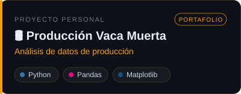
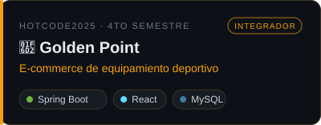
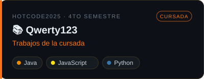

<p align="center">
  
</p>

<p align="center">
  <a href="https://www.linkedin.com/in/jes%C3%BAs-alberto-ch%C3%A1vez-871659365/"></a>
  <a href="https://github.com/SSJesusChavez/portafolio"></a>
</p>

## 👨‍🏫 Sobre mí

Actualmente me desempeño como **profesor de Informática de nivel medio**, donde enseño temas como bases de datos, y soy estudiante de la **Tecnicatura Universitaria en Programación** en la UTN FRSR. Mi objetivo es desempeñarme en el **sector energético**, combinando el **análisis de datos** con Python y Pandas con mi experiencia en **compresión de gas**: manejo de equipos compresores **Ariel** y **PLC**. Me interesa especialmente **Vaca Muerta** y también crear contenido de tecnología.

```yaml
docencia:     Profesor de Informática — nivel medio · bases de datos
estudio:      Tecnicatura Universitaria en Programación — UTN FRSR
datos:        Python · Pandas · limpieza, análisis y visualización
industria:    Compresión de gas · compresores Ariel · PLC
objetivo:     Sector energético (Vaca Muerta) · análisis de datos
```

## 🛠️ Tecnologías

<p>
  
  
  
  
  
  <br/>
  
  
  
  
  <br/>
  
  
  
  <br/>
  
  
  
</p>

## 📂 Proyectos

<p>
  <a href="https://github.com/SSJesusChavez/portafolio/tree/main/proyectos/produccion-vaca-muerta"></a>
</p>

- **🛢️ Producción Vaca Muerta:** análisis con Python y Pandas de la producción mensual de petróleo y gas por área: totales por año, crecimiento interanual, ranking de áreas y gráficos. Está en mi [portafolio](https://github.com/SSJesusChavez/portafolio).

## 🤝 Proyectos en equipo

Proyectos del grupo **Qwerty123** en la organización **HotCode2025**: a la izquierda el proyecto integrador y a la derecha el repo con los trabajos de la cursada.

<p>
  <a href="https://github.com/HotCode2025/Qwerty123-ProyectoIntegrador-Ecommerce-CuartoSemestre"></a>
  <a href="https://github.com/HotCode2025/Qwerty123-Cuarto-Semestre"></a>
</p>

- **🛒 Golden Point:** e-commerce de fútbol, básquet y pádel con API REST en Java + Spring Boot, frontend en React + Vite y MySQL. Tiene pagos con Mercado Pago, panel de administración y deploy en Vercel, Render y Aiven.
  <a href="https://golden-point-kappa.vercel.app/"></a>
- **📚 Qwerty123 — Cuarto semestre:** los trabajos de la cursada en Java, Python y JavaScript, hechos en equipo con mis compañeros.

<!-- Próximos proyectos: agregar una tarjeta en /profile y una línea en la lista de arriba -->

---

<p align="center"><sub>¿Hablamos de datos, energía o docencia? Escribime por LinkedIn.</sub></p>
